# ARQUITECTURA DE INFORMACIÓN — CLÍNICA VETERINARIA «PATITAS FELICES»
**Rol:** Diseñador UI/UX Senior  
**Proyecto:** Sitio Web Responsive «Patitas Felices»  
**Fase:** 2. Arquitectura de Información (IA)  
**Fecha:** Octubre 2026  

---

## 1. Sitemap Jerárquico del Sitio Web

El sitemap organiza de manera jerárquica y lógica todas las pantallas del ecosistema digital de Patitas Felices, garantizando que ninguna pantalla crítica se encuentre a más de **2 clics de distancia** desde la página de inicio.

### 1.1 Elementos Globales y Persistentes (Cross-Page)
* **Header Fijo (Sticky Navbar):**
  * Logotipo corporativo con isotipo de pata amable (enlace a Nivel 0: Inicio).
  * Menú principal de navegación (Nivel 1).
  * Teléfono de contacto directo con microcopia: *(2) 2345-6789*.
  * **Botón SOS Emergencias:** Botón con alto contraste visual (rojo carmín #D32F2F) visible en todo momento.
  * **CTA Principal:** Botón destacado *"Agendar Cita"* (verde confianza #2E7D32).
* **Barra Móvil Flotante Inferior (Sticky Bottom Bar en viewport < 768px):**
  * Botón directo *"Llamar a Emergencias (24h)"* a la izquierda.
  * Botón expansivo *"Agendar Cita Ahora"* a la derecha.
* **Footer Global (Pie de Página):**
  * Resumen de la clínica (8 años cuidando a las mascotas del barrio).
  * Horarios de atención regular y régimen de urgencias.
  * Dirección física con micro-mapa interactivo e indicación de accesibilidad sin escalones.
  * Enlaces rápidos a Servicios, Equipo y Preguntas Frecuentes.
  * Canales oficiales: WhatsApp, Instagram, Google Maps Reviews.
  * Certificaciones médicas y aviso de privacidad legal.

---

### 1.2 Estructura en Árbol (Jerarquía de Pantallas)

```
NIVEL 0: INICIO (PANTALLA 1)
│
├── NIVEL 1: SERVICIOS Y PRECIOS (PANTALLA 2)
│   ├── Nivel 2: Detalle de Consulta Médica General y Felina (PANTALLA 3)
│   ├── Nivel 2: Detalle de Vacunación y Desparasitación
│   ├── Nivel 2: Detalle de Cirugía y Procedimientos Menores
│   ├── Nivel 2: Detalle de Peluquería Canina y Spa
│   └── Nivel 2: Detalle de Protocolo de Urgencias Médicas
│
├── NIVEL 1: NUESTRO EQUIPO (PANTALLA 4)
│   └── Nivel 2: Perfil individual de veterinarios (credenciales, foto y especialidad)
│
├── NIVEL 1: AGENDAR CITA (FLUJO MULTIPASO TRANSACCIONAL)
│   ├── Nivel 2: Paso 1: Selección de Servicio y Registro de Mascota (PANTALLA 5)
│   ├── Nivel 2: Paso 2: Selección de Fecha y Hora en Calendario (PANTALLA 6)
│   ├── Nivel 2: Paso 3: Datos del Tutor y Resumen de Pre-confirmación (PANTALLA 7)
│   └── Nivel 2: Pantalla de Cita Confirmada y Voucher Digital (PANTALLA 8)
│
├── NIVEL 1: CONTACTO Y UBICACIÓN (PANTALLA 9)
│   └── Nivel 2: Mapa interactivo, rutas en Waze/Google Maps, teléfonos y formulario directo
│
└── PANTALLA DEL SISTEMA (ERROR):
    └── Página de Error 404 personalizada con buscador y rescate a Inicio/Agendar (PANTALLA 10)
```

---

### 1.3 Mapeo y Cobertura de las 10 Pantallas Requeridas

| ID Pantalla | Nombre de Pantalla | Nivel IA | Descripción y Contenido Clave |
| :---: | :--- | :---: | :--- |
| **01** | **Inicio (Home)** | Nivel 0 | Hero con CTA dual (Agendar / Urgencias), servicios destacados, credenciales de 8 años, testimonios en Google Maps y bloque de contacto rápido. |
| **02** | **Servicios y Tarifas** | Nivel 1 | Catálogo completo (consulta, vacunación, cirugía, peluquería, urgencias) con precios referenciales "desde", tiempos y badges de preparación previa. |
| **03** | **Detalle de Servicio** | Nivel 2 | Ficha en profundidad (ej: Consulta Médica Integral): qué incluye, preparación previa de la mascota, veterinarios a cargo y botón directo "Agendar este servicio". |
| **04** | **Nuestro Equipo** | Nivel 1 | Cuadrícula con fotos reales de los médicos veterinarios, número de registro profesional, años de experiencia, áreas de especialidad y trato cariñoso. |
| **05** | **Agendar Cita (Paso 1)** | Nivel 2 | Selector interactivo de servicio y registro básico de la mascota: Tipo (Perro/Gato/Otro), Nombre, Edad y motivo de consulta. |
| **06** | **Agendar Cita (Paso 2)** | Nivel 2 | Calendario mensual interactivo con selección de slots horarios en tiempo real (bloques de 30 min) clasificados en mañana y tarde. |
| **07** | **Agendar Cita (Paso 3)** | Nivel 2 | Formulario simple de datos del tutor (Nombre, WhatsApp, Email opcional) + resumen visual de la cita antes de confirmar. |
| **08** | **Cita Confirmada** | Nivel 2 | Pantalla de confirmación con código de cita, botón *"Agregar a Google/Apple Calendar"*, botón *"Enviar a WhatsApp"* e indicaciones de llegada. |
| **09** | **Contacto y Ubicación** | Nivel 1 | Mapa geolocalizado interactivo, botones directos de navegación (Waze/Google Maps), horarios detallados y botón de llamada telefónica directa. |
| **10** | **Página de Error 404** | Sistema | Pantalla con ilustración empática de mascota ("¡Ups! Esta patita se desvió del camino"), buscador rápido y botones para volver al Inicio o Agendar. |

---

### 1.4 Justificación de la Organización del Menú Principal (4 Líneas)

> Basándonos en el card sorting de las proto-personas, Valentina requería consultar precios y agendar sin rodeos, Don Carlos saber de inmediato quién lo atenderá y cómo llegar, y Mariana acceder al calendario sin perder tiempo. Se redujo el menú a **4 secciones informativas clave más un botón transaccional de acción**, eliminando categorías corporativas redundantes. Esta estructura garantiza que el 100% de las tareas críticas se completen a menos de 2 clics, respetando la ley de Hick y las pautas de accesibilidad para evitar la sobrecarga cognitiva.

---

## 2. User Flow: Agendar una Cita Médica

### 2.1 Simbología Utilizada
* **Óvalo `([ ... ])`**: Inicio o Fin del flujo.
* **Rectángulo `[ ... ]`**: Pantalla del sistema o acción concreta del usuario.
* **Rombo `{ ... }`**: Decisión lógica condicional con bifurcación obligatoria («Sí» o «No»).
* **Flecha `-->`**: Dirección secuencial del flujo.

---

### 2.2 Diagrama Completo del User Flow (Mermaid)

```mermaid
flowchart TD
    %% Puntos de Entrada
    EntradaA(["Entrada A: Búsqueda Google / Maps<br>(Aterriza en Pantalla 1: Home)"]) --> Home["Pantalla 1: Inicio<br>(Escaneo visual y propuesta de valor)"]
    EntradaB(["Entrada B: Enlace de Instagram / Campaña<br>(Aterriza directo en reserva)"]) --> DecisionEmergencia
    
    Home --> ClickCTA["Usuario pulsa botón principal<br>'Agendar Cita'"] --> DecisionEmergencia
    
    %% Validación de Emergencia
    DecisionEmergencia{"¿Es una emergencia médica vital?<br>(Paciente en riesgo inminente)"}
    DecisionEmergencia -- "Sí" --> PantallaSOS["Modal SOS / Pantalla de Emergencia:<br>Aviso de atención inmediata presencial"]
    PantallaSOS --> AccionLlamar["Acción: Pulsa botón de llamada directa<br>o escribe a WhatsApp de Guardia 24h"]
    AccionLlamar --> FinSOS(["Fin: Contacto Telefónico Establecido<br>(Atención prioritaria inmediata)"])
    
    %% Camino Ideal - Paso 1
    DecisionEmergencia -- "No" --> Paso1["Pantalla 5: Agendar Paso 1<br>1. Selecciona Servicio (con precio)<br>2. Ingresa Mascota: Especie, Nombre y Edad"]
    
    Paso1 --> IntentoAvanzarPaso1["Usuario pulsa<br>'Continuar a Fecha y Hora'"]
    
    ValidaPaso1{"¿Campos obligatorios completos<br>y válidos?"}
    IntentoAvanzarPaso1 --> ValidaPaso1
    
    ValidaPaso1 -- "No" --> ErrorPaso1["Error Inline (WCAG AA):<br>Destaca campos vacíos en rojo accesible.<br>Foco automático en el primer error."]
    ErrorPaso1 --> Paso1
    
    %% Camino Ideal - Paso 2
    ValidaPaso1 -- "Sí" --> Paso2["Pantalla 6: Agendar Paso 2<br>Calendario interactivo con slots disponibles<br>(Filtro Mañana / Tarde)"]
    
    Paso2 --> RetornoPaso1{"¿Usuario quiere cambiar de servicio<br>o datos de la mascota?"}
    RetornoPaso1 -- "Sí (Clic Atrás)" --> Paso1
    
    RetornoPaso1 -- "No" --> SeleccionaSlot["Usuario selecciona día y bloque de hora"]
    SeleccionaSlot --> ValidaSlot{"¿El horario seleccionado<br>sigue disponible en el servidor?"}
    
    ValidaSlot -- "No (Slot ocupado por concurrencia)" --> ErrorSlot["Notificación Toast:<br>'Este horario acaba de reservarse.<br>Te sugerimos los 3 más cercanos:'"]
    ErrorSlot --> Paso2
    
    ValidaSlot -- "Sí" --> IntentoAvanzarPaso2["Usuario pulsa<br>'Continuar a Mis Datos'"]
    
    %% Camino Ideal - Paso 3
    IntentoAvanzarPaso2 --> Paso3["Pantalla 7: Agendar Paso 3<br>1. Ingresa: Nombre, WhatsApp y Email<br>2. Visualiza resumen completo de la cita"]
    
    Paso3 --> RetornoPaso2{"¿Usuario desea corregir fecha u hora?"}
    RetornoPaso2 -- "Sí (Clic Atrás)" --> Paso2
    
    RetornoPaso2 -- "No" --> IntentoConfirmar["Usuario pulsa botón final<br>'Confirmar mi Cita'"]
    
    ValidaPaso3{"¿Datos de contacto válidos?<br>(Teléfono 9 dígitos / Email válido)"}
    IntentoConfirmar --> ValidaPaso3
    
    ValidaPaso3 -- "No" --> ErrorPaso3["Error Inline descriptivo:<br>'Ingresa un número telefónico válido<br>para enviarte el recordatorio'"]
    ErrorPaso3 --> Paso3
    
    %% Cita Exitosa
    ValidaPaso3 -- "Sí" --> Paso4["Pantalla 8: Cita Confirmada<br>• Código único de reserva<br>• Resumen de servicio, fecha y doctor<br>• Botón 'Añadir a Google/Apple Calendar'<br>• Envío automático de confirmación por WhatsApp"]
    
    Paso4 --> FinExito(["Fin: Cita Agendada Exitosamente<br>(Tiempo total: < 2 minutos)"])
    
    %% Camino de Abandono
    Paso1 -.-> Abandono{"¿Usuario cierra pestaña o pulsa salir?"}
    Paso2 -.-> Abandono
    Paso3 -.-> Abandono
    Abandono -- "Sí" --> ModalAbandono["Modal de Respaldo:<br>'Tus datos no se perderán. Guardamos tu borrador<br>para cuando decidas volver'"]
    ModalAbandono --> FinAbandono(["Fin: Sesión Pausada en LocalStorage"])
```



---

### 2.3 Descripción Detallada de Caminos Alternativos y de Error

#### 1. ¿Es una emergencia médica?
* **Punto de activación:** Banner superior fijo y toggle en el primer paso del agendador: *«¿Tu mascota corre peligro inminente?»*.
* **Comportamiento UX:** Si el usuario selecciona *"Sí"*, se interrumpe el flujo transaccional y se despliega una pantalla modal con fondo ámbar/rojo con:
  * Botón primario de gran tamaño: **«Llamar a Urgencias Ahora»** (`tel:+56223456789`).
  * Botón secundario: **«Iniciar chat urgente por WhatsApp»**.
  * Dirección con botón directo para abrir **Waze** o **Google Maps** en modo navegación hacia la clínica.
* **Objetivo:** Evitar que un animal en paro o shock pierda minutos valiosos llenando formularios.

#### 2. Horario seleccionado no disponible (Concurrencia de reservas)
* **Punto de activación:** Al pulsar un slot horario en la Pantalla 6.
* **Comportamiento UX:** Si otro tutor reservó ese mismo cupo milisegundos antes, el sistema no recarga la página ni borra los datos. Muestra un banner informativo no intrusivo (*Toast notification*):  
  *«El horario de las 10:30 acaba de ocuparse. Te recomendamos: [11:00] [11:30] [16:00]»*.
* **Objetivo:** Prevenir la frustración mediante sugerencias inmediatas con un solo clic.

#### 3. Campos obligatorios vacíos o con formato inválido
* **Punto de activación:** Al presionar *"Continuar"* en el Paso 1 o Paso 3.
* **Comportamiento UX:**
  * No se envían alertas de tipo *alert()* del navegador.
  * Los campos con error cambian su borde a color rojo accesible (#D32F2F) con ícono de advertencia y texto explicativo en lenguaje humano (ej: *«Por favor ingresa un número de teléfono de 9 dígitos para enviarte la confirmación»*).
  * El cursor recibe *auto-focus* en el primer campo inválido.
  * El teclado móvil conmuta automáticamente al formato correspondiente (`type="tel"` abre teclado numérico; `type="email"` abre teclado con arroba).

#### 4. Volver al paso anterior sin perder información
* **Punto de activación:** Botón *"← Volver al paso anterior"* presente en los Pasos 2 y 3, o botón físico «Atrás» del navegador.
* **Comportamiento UX:** Toda la información seleccionada (servicio elegido, nombre de la mascota, fecha marcada) se preserva íntegramente en el estado de la sesión (*sessionStorage* / React state). El usuario puede rectificar sin tener que volver a escribir nada.

#### 5. Abandono voluntario del flujo
* **Punto de activación:** Si el usuario intenta salir cerrando la ventana o navegando hacia otro enlace del menú.
* **Comportamiento UX:** Se activa un diálogo de advertencia amigable: *«¿Deseas pausar tu cita? Guardamos tus datos para que puedas retomarla más tarde»*. Si acepta salir, los datos del borrador se preservan temporalmente durante 2 horas en el navegador del usuario.

---

## 3. Conteo Total de Pasos y Auditoría de Tiempos del Camino Ideal

### 3.1 Recorrido Óptimo (Happy Path) desde Entrada A (Google $\rightarrow$ Home):

| # | Pantalla | Acción Concreta del Usuario | Tipo de Interacción | Tiempo Estimado |
| :-: | :--- | :--- | :---: | :-: |
| **1** | **Pantalla 1 (Home)** | Clic en el botón CTA principal *"Agendar Cita"*. | 1 clic táctil | 3 seg |
| **2** | **Pantalla 5 (Paso 1)** | Selecciona tarjeta del servicio (ej: *Consulta Médica*). | 1 clic | 4 seg |
| **3** | **Pantalla 5 (Paso 1)** | Selecciona especie (chip: *Perro* / *Gato*) y escribe nombre y edad de la mascota. | 1 tap + escritura rápida | 15 seg |
| **4** | **Pantalla 5 (Paso 1)** | Clic en *"Continuar a Fecha y Hora"*. | 1 clic | 2 seg |
| **5** | **Pantalla 6 (Paso 2)** | Selecciona el día deseado en el calendario visual. | 1 clic | 5 seg |
| **6** | **Pantalla 6 (Paso 2)** | Selecciona el slot de horario disponible (ej: *10:30 AM*). | 1 clic | 4 seg |
| **7** | **Pantalla 6 (Paso 2)** | Clic en *"Continuar a Mis Datos"*. | 1 clic | 2 seg |
| **8** | **Pantalla 7 (Paso 3)** | Ingresa Nombre y Teléfono (con autocompletado del móvil). | Autocompletado navegador | 10 seg |
| **9** | **Pantalla 7 (Paso 3)** | Clic en botón final *"Confirmar mi Cita"*. | 1 clic | 2 seg |
| **10**| **Pantalla 8 (Éxito)** | Visualiza voucher, pulsa *"Guardar en Calendario"* o *"Enviar a WhatsApp"*. | 1 clic | 5 seg |

### 3.2 Balance Final del Camino Ideal:
* **Total de Pantallas recorridas:** 4 pantallas (Home $\rightarrow$ Paso 1 $\rightarrow$ Paso 2 $\rightarrow$ Paso 3 $\rightarrow$ Confirmación).
* **Total de Clics / Taps mínimos:** **7 clics esenciales**.
* **Campos de texto obligatorios:** Solo 3 datos estrictos (Nombre de mascota, Nombre de tutor y Teléfono móvil).
* **Tiempo total invertido:** **~52 segundos** (en condiciones normales con autocompletado móvil) o **~75 segundos** con digitación manual pausada.
* **Cumplimiento de la meta de diseño:** **Aprobado con creces.** Se completa holgadamente por debajo de los **120 segundos (2 minutos)** establecidos en el requerimiento del proyecto.
